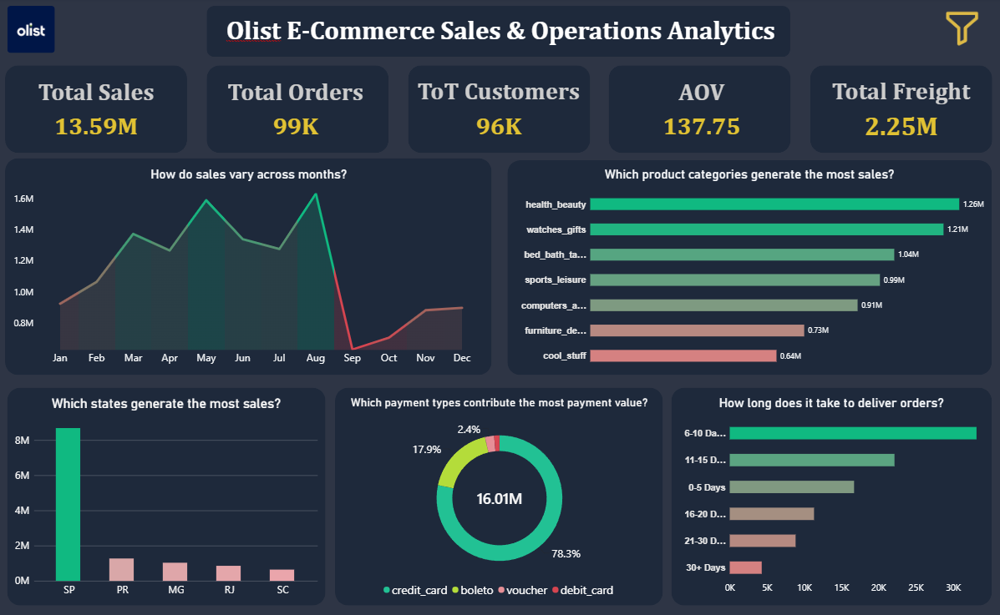
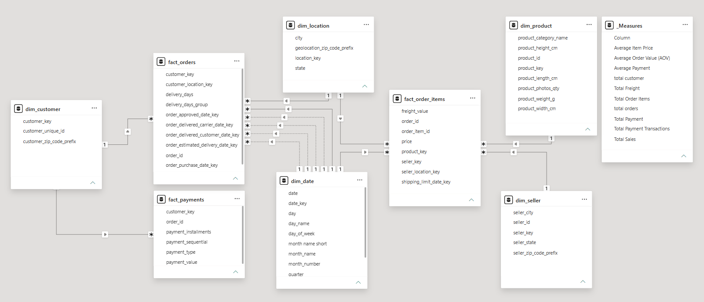
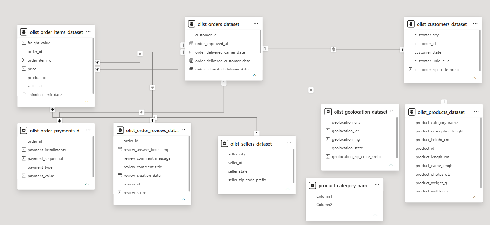

# Olist E-Commerce Sales & Operations Analytics

A mini end-to-end Power BI project focused on **data modeling, Power Query transformations, Fact Constellation (Galaxy Schema) design, and DAX** using the Brazilian E-Commerce Public Dataset by Olist.

> **Main Goal:** Apply dimensional modeling concepts in a realistic e-commerce dataset and build a clean analytical model before creating the dashboard.

---

## Table of Contents

- [Dashboard Preview](#dashboard-preview)
- [Project Objective](#project-objective)
- [Dataset](#dataset)
- [Data Modeling Approach](#data-modeling-approach)
- [Fact Constellation Schema](#fact-constellation-schema)
- [Data Preparation](#data-preparation)
- [Important Modeling Decisions](#important-modeling-decisions)
- [DAX Measures](#dax-measures)
- [Business Questions](#business-questions)
- [Dashboard](#dashboard)
- [Key Findings](#key-findings)
- [Before & After](#before--after)
- [Key Challenges](#key-challenges)
- [Validation](#validation)
- [How to Run](#how-to-run)
- [Tools & Technologies](#tools--technologies)
- [Project Structure](#project-structure)
- [What I Learned](#what-i-learned)
- [Future Improvements](#future-improvements)
- [Project Status](#project-status)

---

## Dashboard Preview



---

## Project Objective

This project was created as a practical exercise to strengthen my understanding of:

- Dimensional Data Modeling
- Grain definition
- Fact and Dimension design
- Fact Constellation / Galaxy Schema
- Primary, Business, Foreign, and Surrogate Keys
- Power Query / M transformations
- Relationship design in Power BI
- DAX measures
- Analytical dashboard design

The main focus of the project is **the data model**, not the dashboard itself.

---

## Dataset

**Brazilian E-Commerce Public Dataset by Olist**

The original dataset is publicly available on Kaggle:

[Brazilian E-Commerce Public Dataset by Olist — Kaggle](https://www.kaggle.com/datasets/olistbr/brazilian-ecommerce)

The dataset contains information about:

- Orders
- Order Items
- Payments
- Products
- Customers
- Sellers
- Geolocation
- Reviews
- Product Category Translations

> **Note:** The raw dataset is not included in this repository. Download it directly from Kaggle to reproduce the project.

**License:** CC BY-NC-SA 4.0

**Dataset Provider:** Olist

---

## Data Modeling Approach

Before building the model, I defined the **grain of each table** and identified the appropriate business process.

### Fact Tables

| Table | Grain |
|---|---|
| `fact_orders` | One row represents one order |
| `fact_order_items` | One row represents one order item / order line |
| `fact_payments` | One row represents one payment line within an order |

### Dimension Tables

| Table | Grain |
|---|---|
| `dim_customer` | One row represents one unique customer |
| `dim_product` | One row represents one product |
| `dim_seller` | One row represents one seller |
| `dim_location` | One row represents one ZIP code prefix |
| `dim_date` | One row represents one calendar date |

The review table was excluded from the final model because it was outside the scope of the analysis.

---

## Fact Constellation Schema



The final model follows a **Fact Constellation (Galaxy Schema)** where multiple fact tables represent different business processes and share common dimensions.

### Key Relationships

- `dim_customer` → `fact_orders`
- `dim_location` → `fact_orders`
- `dim_product` → `fact_order_items`
- `dim_seller` → `fact_order_items`
- `dim_location` → `fact_order_items`
- `dim_customer` → `fact_payments`
- `dim_date` → fact tables through date keys

The same `dim_location` is used in different roles:

- Customer / delivery location
- Seller location

---

## Data Preparation

Power Query was used to transform the raw source tables into analytical tables.

Main transformations included:

- Data type correction
- Removing exact duplicate geolocation rows
- Grouping geolocation by ZIP code prefix
- Standardizing city names
- Integrating product category translations
- Creating surrogate keys
- Resolving customer identity using `customer_unique_id`
- Mapping customers and sellers to location keys
- Creating date keys
- Converting timestamps to analysis-ready dates
- Creating delivery duration groups

---

## Important Modeling Decisions

### Customer Identity

The dataset contains both:

- `customer_id`
- `customer_unique_id`

`customer_id` is associated with an individual order, while `customer_unique_id` allows the same real customer to be identified across multiple orders.

Therefore:

```text
customer_unique_id → Business Key
customer_key       → Surrogate Key
```

This allowed the customer dimension to maintain:

> **One row per unique customer**

while multiple orders can reference the same `customer_key`.

---

### Order Items Grain

`order_items` contains repeated `order_id` values because one order can contain multiple order lines.

The row is identified by:

```text
order_id + order_item_id
```

This prevented valid order lines from being incorrectly treated as duplicates.

---

### Payment Grain

Payments were modeled separately because:

> **One order can contain multiple payment records.**

The payment grain is:

```text
order_id + payment_sequential
```

Payments were not merged into `fact_order_items` because the two tables represent different business events and have different grains.

---

### Location Modeling

The raw geolocation table contained multiple records for the same ZIP prefix, including repeated rows and multiple coordinate records.

For the analytical model, the location dimension was standardized to:

> **One row per ZIP code prefix**

with:

- ZIP code prefix
- City
- State
- Location Key

Seller and customer locations are handled through the same location dimension using different foreign keys.

---

## DAX Measures

Core measures created for the model include:

- Total Sales
- Total Orders
- Total Customers
- Total Order Items
- Total Freight
- Average Order Value
- Average Item Price
- Total Payment
- Average Payment
- Total Payment Transactions

These measures were designed according to the grain of each fact table to avoid double counting.

---

## Business Questions

The dashboard was designed around a small set of business questions:

### Sales Trend

**How do sales vary across months?**

### Product Performance

**Which product categories generate the most sales?**

### Geographic Performance

**Which states generate the most sales?**

### Delivery Performance

**How long does it take to deliver orders?**

### Payment Analysis

**Which payment types contribute the most payment value?**

---

## Dashboard

The final dashboard contains:

- 5 KPI cards
- 5 analytical visuals
- Consistent color palette
- Business-question-driven visual titles
- A single-page layout

### Main KPIs

| KPI | Value |
|---|---:|
| Total Sales | **13.59M** |
| Total Orders | **99K** |
| Total Customers | **96K** |
| Average Order Value | **137.75** |
| Total Freight | **2.25M** |

---

## Key Findings

The dashboard provides several high-level insights from the analyzed data:

- **Total Sales reached 13.59M** across approximately **99K orders** and **96K customers**.
- **Average Order Value (AOV) is 137.75**, providing a high-level view of the average revenue generated per order.
- **Health & Beauty** is the highest-performing product category in the dashboard, generating approximately **1.26M** in sales.
- **São Paulo (SP)** is the leading state by sales, significantly outperforming the other top states shown in the dashboard.
- **Credit card payments dominate payment value**, accounting for **78.3%**, followed by **boleto at 17.9%**.
- Delivery performance is concentrated around the **6–10 day range**, which is the largest delivery-duration group in the dashboard.

These findings demonstrate how the analytical model can be used to move from raw transactional data to business-oriented insights.

---

## Before & After

### Before — Raw / Source-Oriented Structure



### After — Analytical Fact Constellation Schema


The transformation focused on moving from source-oriented tables toward a model optimized for analytical queries and Power BI reporting.

---

## Key Challenges

### 1. Understanding Table Grain

One of the first challenges was identifying what each row actually represented.

For example:

```text
orders       → one order
order_items  → one order line
payments     → one payment line
```

This prevented incorrect duplicate removal and incorrect joins.

### 2. Customer ID vs Customer Unique ID

A single real customer can have multiple `customer_id` values across different orders.

The model therefore uses `customer_unique_id` as the business key for the customer dimension.

### 3. Many-to-Many Risk in Geolocation

The raw geolocation data contained multiple records for the same ZIP prefix.

Instead of creating a many-to-many relationship, the location dimension was transformed to one row per ZIP prefix.

### 4. Different Business Processes

Orders, order items, and payments were kept as separate facts because they represent different business processes and grains.

### 5. Role-Based Location

Customer delivery location and seller location use the same location dimension but represent different roles in the business process.

---

## Validation

The model was validated through checks including:

- Primary key uniqueness
- Composite key uniqueness
- Fact-to-dimension cardinality
- Null / missing key checks
- Duplicate detection
- Customer identity validation
- Location mapping validation
- Measure sanity checks
- Visual filtering validation

---

## How to Run

### 1. Download the Dataset

Download the original Olist dataset from Kaggle:

[Brazilian E-Commerce Public Dataset by Olist](https://www.kaggle.com/datasets/olistbr/brazilian-ecommerce)

The raw CSV files should remain outside the repository.

### 2. Open the Power BI File

Open:

```text
PowerBI/
└── Olist-E-commerce sales & operational analysis.pbix
```

using **Power BI Desktop**.

### 3. Configure the Data Source

If the raw CSV files are stored in a different location, update the source paths in **Power Query**.

### 4. Refresh the Model

After the source paths are configured:

1. Open the `.pbix` file.
2. Go to **Home → Refresh**.
3. Make sure all Power Query transformations complete successfully.
4. Verify the relationships and measures in the model.

The dashboard should then reproduce the analytical model and visuals shown in this repository.

---

## Tools & Technologies

- **Power BI**
- **Power Query**
- **M Language**
- **DAX**
- **Dimensional Modeling**
- **Fact Constellation / Galaxy Schema**

---

## Project Structure

```text
Olist-E-Commerce-Analytics/
│
├── README.md
│
├── PowerBI/
│   └── Olist-E-commerce sales & operational analysis.pbix
│
└── images/
    ├── dashboard.png
    ├── after_data_modeling.png
    └── before_data_modeling.png
```

## Project Status

**Completed — Mini Data Modeling Project**

The primary goal of this project was to practice and validate **Power BI data modeling concepts** in a realistic e-commerce scenario.
